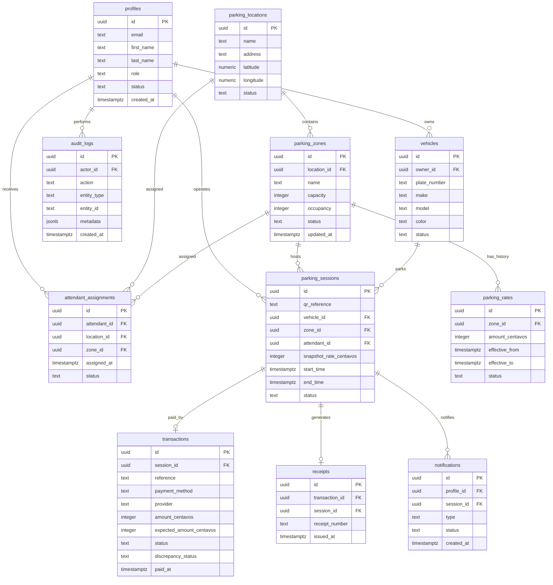

# Entity Relationship Design

## 1. Initial Entities

1. `profiles`
2. `vehicles`
3. `parking_locations`
4. `parking_zones`
5. `parking_rates`
6. `attendant_assignments`
7. `parking_sessions`
8. `transactions`
9. `receipts`
10. `notifications`
11. `audit_logs`

## 2. ERD



## 3. Cardinality Summary

- One profile owns multiple vehicles.
- One location contains multiple zones.
- One zone has one active rate and historical rate records.
- One attendant may be assigned to multiple zones.
- One vehicle may have many parking sessions across time but only one active session.
- One parking session has at most one successful transaction in the initial model.
- One successful transaction generates at most one receipt.
- Notifications belong to a profile and may reference a session.

## 4. Required Constraints

- Vehicles: normalized plate number unique per owner or system policy approved later.
- Zones: capacity is non-negative and occupancy cannot exceed capacity.
- Sessions: valid status values and an assigned attendant.
- Transactions: amount is non-negative.
- QR references: unique and unpredictable.
- Profiles: role must be one of the four supported roles.
- Receipts: unique receipt number and one-per-transaction policy.

## 5. Active Session Protection

The database shall include a partial unique constraint equivalent to:

```sql
CREATE UNIQUE INDEX active_session_per_vehicle
ON parking_sessions (vehicle_id)
WHERE status = 'ACTIVE';
```

Final migration syntax will be implemented only during the database phase.

## 6. Historical Rates

Every parking session stores `snapshot_rate_centavos`. This prevents later rate edits from changing previously completed transactions.
