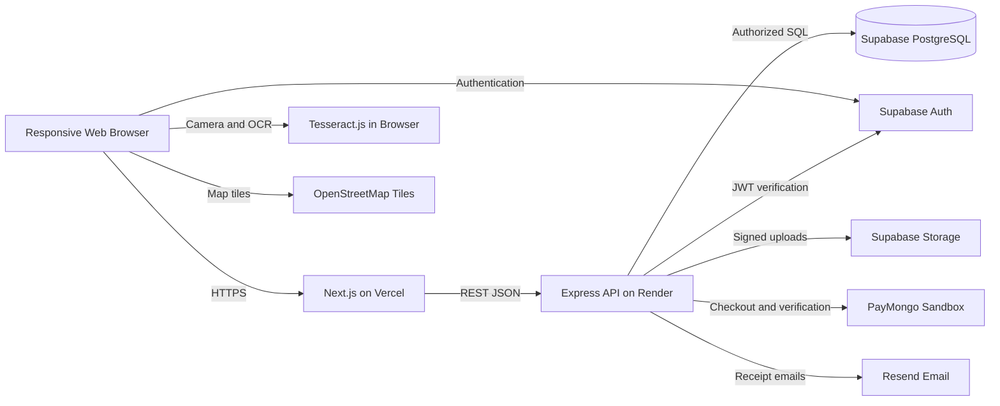
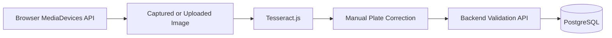
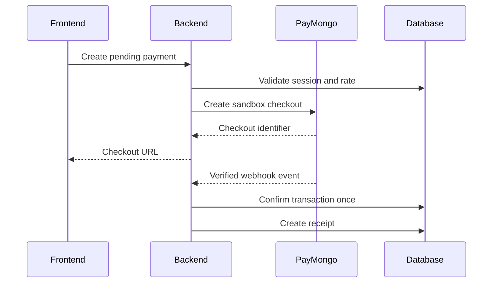

# System Architecture

## 1. Deployment Architecture



## 2. Frontend Architecture

The Next.js frontend will use:

- App Router
- Server and client components where appropriate
- TypeScript
- Tailwind CSS
- Role-aware route protection
- Reusable UI components
- Feature modules separated by domain

Suggested feature structure:

```text
frontend/features/
├── auth/
├── driver/
├── vehicles/
├── parking/
├── sessions/
├── payments/
├── receipts/
├── admin/
└── audit/
```

Sensitive authorization decisions shall be enforced by the backend and database; frontend role checks are for navigation only.

## 3. Backend Architecture

```text
backend/src/
├── config/
├── middleware/
├── routes/
├── controllers/
├── services/
├── validators/
├── utils/
└── types/
```

Responsibilities:

- Routes: HTTP method and path declarations
- Controllers: request and response handling
- Services: business logic
- Validators: Zod or equivalent schema validation
- Middleware: authentication, authorization, audit, rate limiting
- Config: Supabase and provider configuration
- Utils: normalization, secure references, receipt helpers

## 4. Database Architecture

Supabase PostgreSQL will store application data and enforce security through:

- Foreign keys
- Check constraints
- Unique constraints
- Indexes
- Transactions
- Functions
- Row Level Security policies

The backend uses a server-only Supabase connection. The browser shall not receive a service-role key.

## 5. Camera Architecture



Temporary images used by OCR remain browser-side unless a feature explicitly requires image storage.

## 6. Map Architecture

- Leaflet renders the interactive map.
- OpenStreetMap supplies map tiles.
- PostgreSQL stores latitude and longitude coordinates.
- Browser geolocation is requested only after explicit user action or an explained UI prompt.
- A location or zone link provides external navigation directions.

## 7. Payment Architecture



PayMongo webhooks and provider API status checks must verify the payment. Frontend callbacks are informational only.

## 8. Error Handling

Every API response shall use a consistent structure:

```json
{
  "success": false,
  "error": {
    "code": "VALIDATION_ERROR",
    "message": "Readable explanation"
  }
}
```

Production logs shall exclude secrets and unnecessary personal information.

## 9. Infrastructure Guardrails

- Free hosting must use HTTPS.
- Render and Vercel environment variables must be configured separately.
- Supabase credentials must be restricted appropriately.
- CORS shall allow only approved frontend origins in production.
- Database migrations shall be reviewed before deployment.
- Backups and security assessments are required before real sensitive data is processed.
