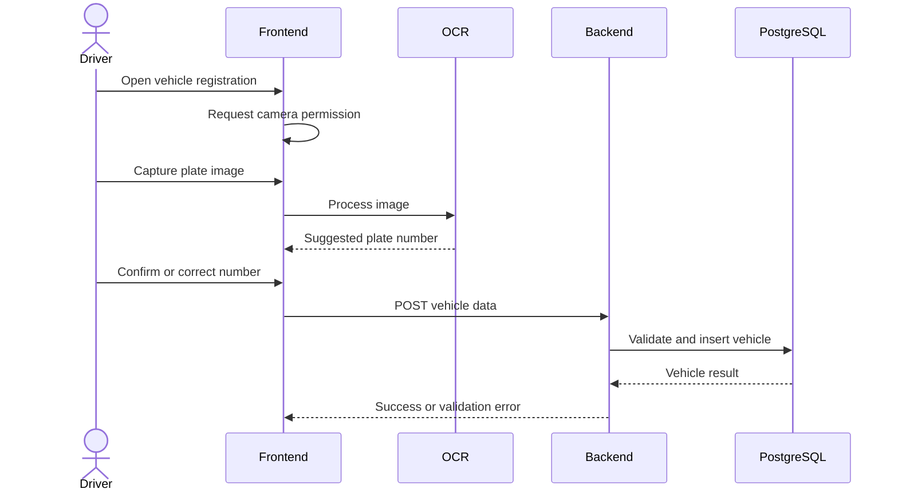
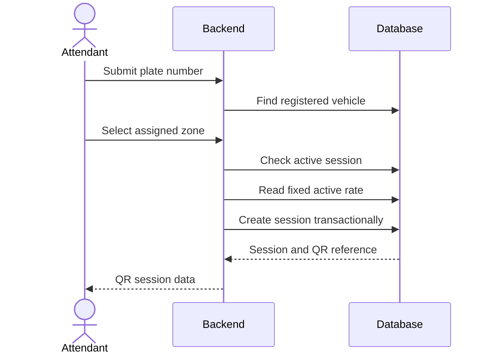
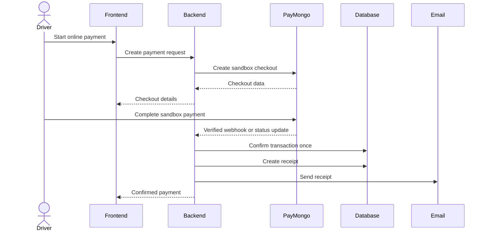
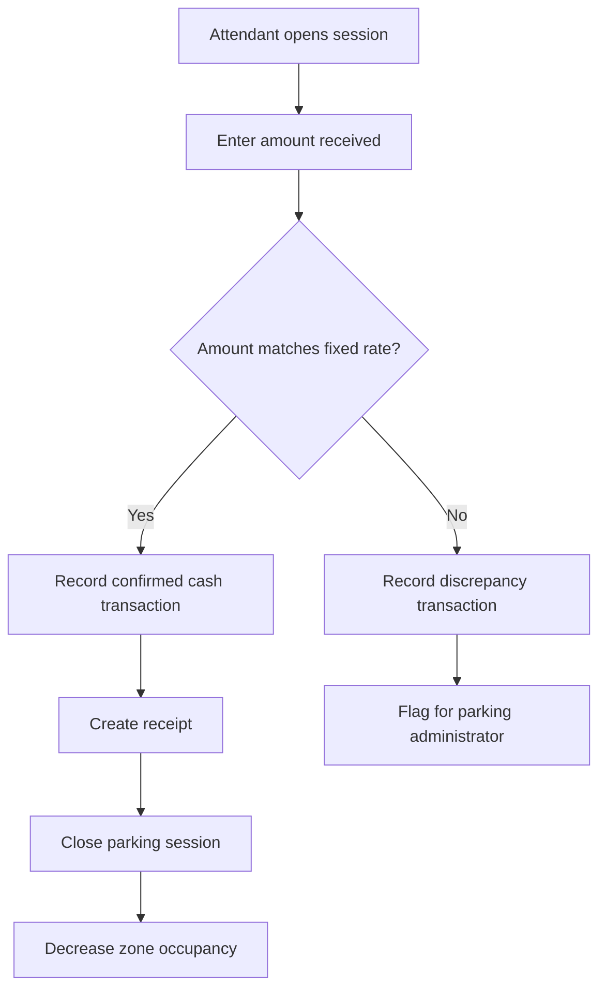

# Core System Workflows

## 1. Vehicle Registration

## 2. Parking Session Creation

## 3. Payment and Receipt

## 4. Cash Payment and Session Closure

## 5. Availability Update

Occupancy changes are derived from valid active sessions and updated transactionally.

- Session creation: increment occupancy if below capacity.
- Session closure: decrement occupancy.
- Administrator availability: manually close or correct the operational status according to audited procedures.

The system does not infer occupancy from GPS or cameras.